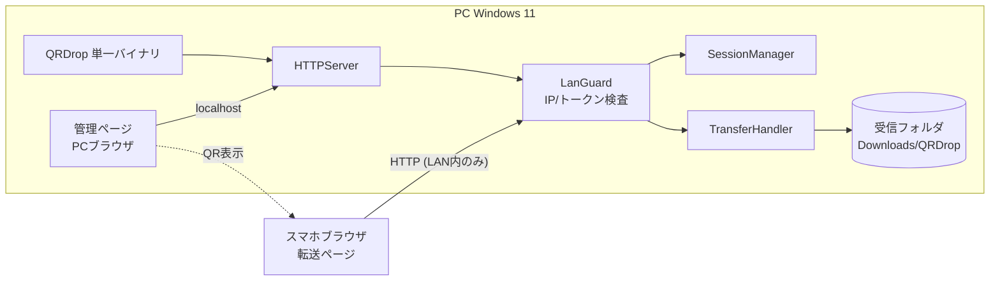
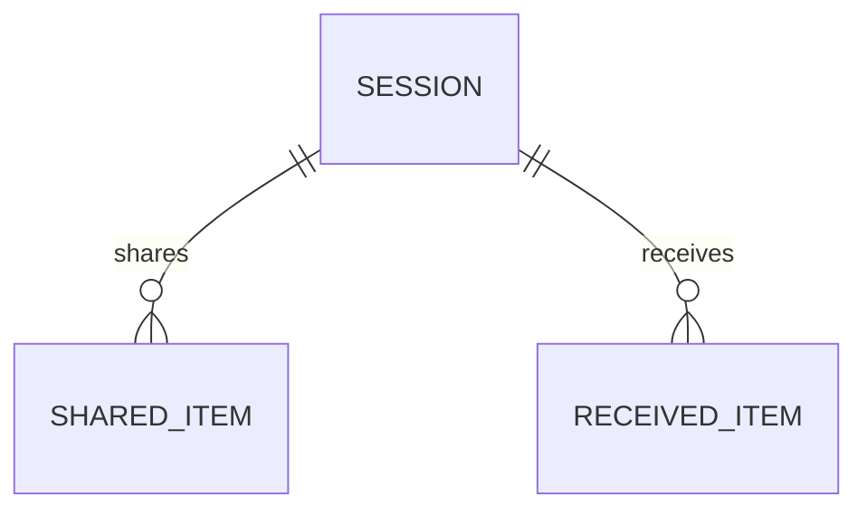
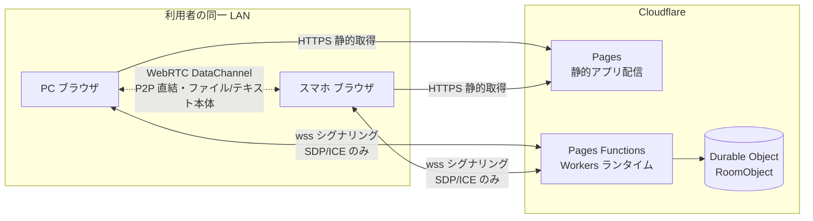
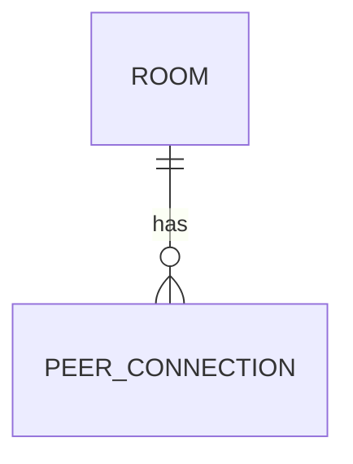

# 設計書 (Design Document) — QR コード LAN データ転送

## 変更履歴

| 日付 | 変更内容 | G2 再承認 |
|------|----------|-----------|
| 2026-07-13 | v2(Web サービス化)を追加。§11〜20(DES-101〜106)を新設(DEC-010、adr-003、adr-004)。v1(§1〜10)は既存どおり据え置き・変更なし | 未(本改訂で依頼) |
| 2026-07-09 | 初版(ドラフト・G2 承認待ち) | 2026-07-11(DEC-006 経由) |

## 0. 版構成(v1 / v2)

v1(§1〜10。デスクトップ版・LAN 限定・リリース済み)は本改訂で変更しない。
v2(§11〜20。Web 版)を新設し、Cloudflare 上で公開する構成を追加する
(DEC-010、adr-003、adr-004)。両者は別成果物として併存する。

## 1. 全体構成(v1: デスクトップ版。変更なし)



Go 製の単一バイナリ。起動すると LAN アドレスで HTTP サーバを立ち上げ、PC の既定
ブラウザで管理ページ(localhost 経由)を開く。スマホは QR で得た URL から転送ページに
アクセスする。すべての要求は LanGuard(プライベート IP 検査+トークン検査)を通る。
外部サーバ・クラウドは一切使わない(REQ-004)。

## 2. 技術スタック

| 層 | 技術 | 選定理由 | ADR |
|----|------|----------|-----|
| サーバ本体 | Go 1.22+(net/http 標準ライブラリ) | 単一バイナリ配布・クロスコンパイル可・標準で十分な HTTP 機能 | [adr-001](adr/adr-001-architecture.md) |
| QR 生成 | github.com/skip2/go-qrcode(PNG 生成) | 実績ある MIT ライセンスの軽量ライブラリ | — |
| 画面 | サーバ埋め込みの静的 HTML/CSS/JS(go:embed)+ SSE | ビルド済みバイナリに同梱、フレームワーク不要の規模 | — |
| 通信保護 | HTTP + ワンタイムトークン + プライベート IP 検査 | 自己署名 HTTPS はスマホの警告で QR 体験を壊すため不採用 | [adr-002](adr/adr-002-transport-security.md) |

## 3. コンポーネント設計

### DES-001: Bootstrap(起動・NIC 検出)

- **責務**: LAN の IPv4 アドレス検出(プライベート範囲のインターフェースを列挙、複数あれば管理ページで選択)、空きポートの確保(既定 8931、使用中なら自動加算)、管理ページの自動オープン(`http://127.0.0.1:<port>/admin`)。LAN 未接続時はエラー表示して終了(REQ-001 異常系)。
- **対応要件**: REQ-001
- **インターフェース**: `main()` からの起動シーケンス
- **依存**: DES-002, DES-006

### DES-002: SessionManager

- **責務**: トークンの生成(`crypto/rand` 128bit → base64url)、TTL 管理(既定 30 分、失効時に転送ページへ 403 + 再読取案内)、手動失効と再発行(REQ-005)。トークンとセッション状態(作成時刻、接続済みデバイス数)をメモリ保持。
- **対応要件**: REQ-001, REQ-005, NFR-002
- **インターフェース**: `NewSession() Session` / `Validate(token) error` / `Revoke()`
- **依存**: なし

### DES-003: TransferHandler

- **責務**: アップロード(`POST /s/<token>/upload`、multipart streaming で受信フォルダへ直接書き出し=メモリに全量を載せない)、ダウンロード(`GET /s/<token>/files/<id>`)、テキスト送受(`POST/GET .../text`)。同名ファイルは ` (1)` 連番付与(REQ-002)。サイズ上限 2GB、超過時 413(NFR-001/002)。共有一覧・テキストはメモリ保持のみ(NFR-005)。
- **対応要件**: REQ-002, REQ-003, REQ-006, NFR-001, NFR-005
- **インターフェース**: HTTP ハンドラ群(§5 API 一覧)
- **依存**: DES-002, DES-004, ファイルシステム

### DES-004: LanGuard(セキュリティミドルウェア)

- **責務**: 全要求に対し (1) 接続元 IP がプライベート範囲(RFC1918 + リンクローカル)であること、(2) `/admin` はループバックのみ許可、(3) `/s/<token>/...` はトークン有効性、を検査。違反は 403。ファイル名サニタイズ(`filepath.Base` + 禁止文字除去)でパストラバーサル防止。UPnP 等のポート開放要求は実装しない(NFR-002 / REQ-004)。
- **対応要件**: REQ-004, NFR-002
- **インターフェース**: `http.Handler` ミドルウェア
- **依存**: なし

### DES-005: WebUI(管理ページ・転送ページ)

- **責務**: 管理ページ(QR 表示、受信一覧、送信ファイル追加 D&D、テキスト送受、セッション終了ボタン)と転送ページ(ファイル選択・送信、共有一覧・ダウンロード、テキスト送受、進捗バー)。一覧更新は SSE(`GET .../events`)で即時反映(REQ-003 の「数秒以内」)。モバイルファーストの単一 CSS。
- **対応要件**: REQ-001, REQ-002, REQ-003, REQ-006
- **インターフェース**: 静的アセット(go:embed)
- **依存**: DES-003 の API

### DES-006: QRDisplay

- **責務**: `http://<LAN-IP>:<port>/s/<token>` の QR コード PNG 生成(`GET /admin/qr.png`)。セッション再発行時に自動更新。
- **対応要件**: REQ-001
- **依存**: DES-002, go-qrcode

### DES-007: Logging

- **責務**: 接続元 IP・操作(upload/download)・ファイル名・結果・拒否理由をローカルログ(`%APPDATA%\QRDrop\logs\`)へ出力。**ファイル内容・テキスト本文は記録しない**(NFR-004)。
- **対応要件**: NFR-004

## 4. データモデル



| エンティティ | 属性 | 型 | 制約 | 保持場所 |
|--------------|------|-----|------|----------|
| Session | token, createdAt, expiresAt | string/time | token 一意・128bit 乱数 | メモリ |
| SharedItem(PC→スマホ) | id, kind(file/text), name, size, path or text | string/int64 | path は PC ローカル絶対パス | メモリ |
| ReceivedItem(スマホ→PC) | id, kind, name, size, savedPath, receivedAt | string/int64 | savedPath は受信フォルダ配下のみ | ファイル+メモリ(一覧) |

アプリ終了で SESSION・一覧は消える。ディスクに残るのは受信ファイル本体のみ(NFR-005)。

## 5. 外部インターフェース

### API 一覧

| メソッド | パス | 概要 | 対応 DES |
|----------|------|------|----------|
| GET | `/admin` | 管理ページ(ループバックのみ) | DES-005 |
| GET | `/admin/qr.png` | QR コード画像 | DES-006 |
| POST | `/admin/share` | PC 側の共有追加(ファイル/テキスト) | DES-003 |
| POST | `/admin/session/revoke` | セッション終了・再発行 | DES-002 |
| GET | `/s/<token>` | 転送ページ(スマホ) | DES-005 |
| POST | `/s/<token>/upload` | スマホ→PC アップロード(multipart) | DES-003 |
| GET | `/s/<token>/items` | 共有一覧(JSON) | DES-003 |
| GET | `/s/<token>/files/<id>` | PC→スマホ ダウンロード | DES-003 |
| POST | `/s/<token>/text` | テキスト送信 | DES-003 |
| GET | `/s/<token>/events` / `/admin/events` | SSE(一覧更新通知) | DES-005 |

### 画面一覧

| 画面 | 概要 | 対応 REQ |
|------|------|----------|
| 管理ページ(PC) | QR 表示・受信一覧・共有追加・セッション終了 | REQ-001, 002, 003, 005 |
| 転送ページ(スマホ) | アップロード・共有一覧・ダウンロード・テキスト | REQ-002, 003, 006 |
| エラーページ | 403(LAN 外・失効)時の案内(再読取促し) | REQ-004, 005 |

## 6. エラー処理・ログ方針

- 4xx: LAN 外アクセス・無効/失効トークン(403、遮断理由はログのみに詳細記録し、応答には最小情報)、サイズ超過(413)、不正ファイル名(400)。
- 5xx: ディスク書込失敗等。転送ページには「PC 側のエラー」と再試行案内を表示。
- アップロード中断(スマホのスリープ等): 部分ファイルは `.part` 拡張子で書き、完了時にリネーム。中断残骸は起動時に削除。
- ログ: DES-007 の方針(内容は記録しない)。

## 7. セキュリティ設計

DEC-004 の多層防御を実装に落とす(すべて NFR-002 / REQ-004 対応):

1. **バインド**: 選択した LAN インターフェース + ループバックのみで Listen(0.0.0.0 でも良いが LanGuard で遮断されるため二重化)。
2. **接続元検査**: RemoteAddr がプライベート範囲外 → 403。`/admin` はループバック限定。
3. **トークン**: 128bit 暗号乱数、URL パスで伝達、TTL 30 分、手動失効可。検証は定数時間比較。
4. **ポート開放をしない**: UPnP/NAT-PMP 非実装。ルーターのポートフォワード設定は README で明示的に非推奨と記載。
5. **入力検証**: ファイル名サニタイズ(パストラバーサル防止)、サイズ上限、Content-Type 非依存の保存(実行はしない)。
6. **平文 HTTP のリスク**: 同一 LAN 内の盗聴には無防備(ADR-002 で受容判断)。信頼できない LAN での利用は README で非推奨。

## 8. 開発環境・規約

- セットアップ手順:
  ```
  winget install GoLang.Go
  git clone <repo> && cd qrdrop
  go build ./cmd/qrdrop
  .\qrdrop.exe
  # 初回起動時に Windows ファイアウォールの受信許可ダイアログで「許可」する(プライベートネットワークのみ)
  ```
- ディレクトリ構成:
  ```
  qrdrop/
  ├── cmd/qrdrop/main.go     # DES-001
  ├── internal/session/      # DES-002
  ├── internal/transfer/     # DES-003
  ├── internal/guard/        # DES-004
  ├── internal/web/          # DES-005, 006 (go:embed 静的アセット)
  └── internal/logging/      # DES-007
  ```
- コーディング規約: `gofmt` + `go vet` + `staticcheck`
- ブランチ戦略: `feature/TASK-xxx-<slug>` → PR → main

## 9. デプロイ構成

- 配布: `go build` による単一 exe。インストーラなし、任意フォルダで実行。
- ロールバック: 旧 exe に差し替えるのみ(永続データは受信ファイルのみで互換性問題なし)。
- クロスコンパイル余地: `GOOS=darwin/linux` でビルド可(初版の動作確認は Windows のみ = DEC-002)。

## 10. 要件カバレッジ表

| 要件 | 対応 DES | 備考 |
|------|----------|------|
| REQ-001 | DES-001, DES-002, DES-006(+DES-005 表示) | |
| REQ-002 | DES-003, DES-005 | 連番保存含む |
| REQ-003 | DES-003, DES-005 | SSE で即時反映 |
| REQ-004 | DES-004 | 多層防御(§7) |
| REQ-005 | DES-002 | TTL + 手動失効 |
| REQ-006 | DES-005 | Could。進捗は XHR upload.onprogress |
| NFR-001 | DES-003 | ストリーミング書込。P4 で 100MB 実測 |
| NFR-002 | DES-002, DES-003, DES-004 | |
| NFR-003 | — | N/A(要件定義書参照) |
| NFR-004 | DES-007 | |
| NFR-005 | DES-003 | メモリ保持のみ |

## 11. 全体構成(v2: Web 版。DEC-010・adr-003・adr-004 により新設)



Cloudflare が扱うのはルーム管理とシグナリング(制御メタデータ)のみ。ファイル・テキスト
本文は PC ブラウザとスマホブラウザの間の WebRTC DataChannel を直接流れ、Cloudflare を
経由しない(REQ-104、adr-003)。

## 12. 技術スタック(v2)

| 層 | 技術 | 選定理由 | ADR |
|----|------|----------|-----|
| 静的アプリ | TypeScript(ビルド: Vite)+ 素の Web Components または軽量ライブラリ。PC/スマホ共通の単一 SPA | フレームワーク依存を最小化し、v1 と同じく配布物を単純に保つ | — |
| QR 生成 | クライアント側 JS ライブラリ(例: `qrcode`)でブラウザ内生成 | サーバーを経由せずルーム URL を QR 化でき、外部通信が増えない | — |
| シグナリング | Cloudflare Pages Functions(Workers ランタイム)+ Durable Objects(SQLite ストレージバックエンド) | Pages と同一デプロイ単位で完結し、無料枠が本用途に十分(adr-004) | [adr-004](adr/adr-004-cloudflare-hosting.md) |
| P2P 転送 | ブラウザ標準 WebRTC API(`RTCPeerConnection` / `RTCDataChannel`)。`iceServers: []`(STUN/TURN 不使用) | 同一ネットワーク限定を接続方式そのもので担保できる唯一の構成(adr-003) | [adr-003](adr/adr-003-webrtc-p2p.md) |
| ホスティング | Cloudflare Pages(GitHub 連携・自動デプロイ) | 費用ゼロ・帯域無制限(adr-004) | [adr-004](adr/adr-004-cloudflare-hosting.md) |

## 13. コンポーネント設計(v2)

### DES-101: SignalingRouter(Pages Functions エントリポイント)

- **責務**: `POST /api/room` でルーム作成要求を受け、新しい Durable Object インスタンス(ルームトークンを ID として `idFromName` で確保)を初期化する。`GET /ws/room/<token>?role=host|guest` の WebSocket アップグレード要求を対応する Durable Object へ委譲する。
- **対応要件**: REQ-101, REQ-105
- **依存**: DES-102

### DES-102: RoomObject(Durable Object。シグナリング中核)

- **責務**: ルーム状態(§14 データモデル)を保持し、ちょうど2者(host/guest)分の WebSocket 接続のみを受け付ける(3者目の参加は `room-full` エラーで拒否)。参加時に双方の `CF-Connecting-IP` が一致するか検査し、不一致なら即座に `network-mismatch` エラーで拒否する(REQ-104)。SDP/ICE メッセージを host↔guest 間でそのまま中継する(内容を解釈・保存しない)。Durable Object Alarms で TTL(既定 30 分)到達時に自動失効、`hostSecret` を伴う `revoke` 要求で即時失効+新ルーム発行。
- **対応要件**: REQ-101, REQ-104, REQ-105, NFR-102, NFR-105
- **インターフェース**: WebSocket メッセージハンドラ(§15 参照)
- **依存**: なし

### DES-103: WebApp(PC/スマホ共通 静的アプリ)

- **責務**: ルーム作成画面(QR 表示・受信一覧・共有追加・ルーム終了ボタン)と参加画面(ファイル選択・送信、共有一覧・ダウンロード、テキスト送受、進捗バー)。役割(host/guest)は URL(`/` = 作成、`/r/<token>` = 参加)で分岐する単一 SPA。
- **対応要件**: REQ-101, REQ-102, REQ-103, REQ-106
- **依存**: DES-104, DES-106

### DES-104: PeerConnectionManager(クライアント側)

- **責務**: `RTCPeerConnection` を `iceServers: []` で生成し、シグナリング用 WebSocket(DES-101 経由)で SDP offer/answer・ICE candidate を交換する。接続確立のタイムアウト(15 秒目安)を監視し、確立できない場合は「同一ネットワークではない可能性があります」というエラー表示に落とす(REQ-101/104 の受け入れ基準)。
- **対応要件**: REQ-101, REQ-104
- **依存**: DES-102(シグナリング相手)

### DES-105: TransferProtocol(DataChannel 上のプロトコル)

- **責務**: ファイルを 64KB チャンクに分割して `DataChannel.send()` で送信し、`bufferedAmountLow`(閾値設定)でバックプレッシャーを制御する。送信前に `file-meta`(名前・サイズ・id)を送り、受信側はメタデータを見てブラウザの標準ダウンロード(`Blob` + `<a download>` もしくは File System Access API)として保存する。テキストは同一チャネル上の `text` メッセージで送受信。進捗は送信済みバイト数/合計で算出し UI に反映(REQ-106)。
- **対応要件**: REQ-102, REQ-103, REQ-106
- **依存**: DES-104

### DES-106: QRDisplay(v2)

- **責務**: ルーム作成時に払い出された `https://<site>/r/<token>` をクライアント側 JS で QR 画像として描画する(サーバーで生成しない。外部通信の追加なし)。
- **対応要件**: REQ-101
- **依存**: DES-103

## 14. データモデル(v2)



| エンティティ | 属性 | 型 | 制約 | 保持場所 |
|--------------|------|-----|------|----------|
| Room | token, hostSecret, createdAt, expiresAt, status(open/full/expired/revoked) | string/time | token・hostSecret とも 128bit 乱数。token は共有可(QR)、hostSecret は host ブラウザのみが保持し revoke 時に提示 | Durable Object(SQLite) |
| PeerConnection | role(host/guest), remoteIP, connectedAt | string | 1 ルームにつき host/guest 各1接続まで | Durable Object メモリ(WebSocket 接続と対応。DO 停止で消える) |

ファイル・テキスト本文は**いかなる形でも Cloudflare 側に保持されない**(P2P 直接転送のため、
サーバー側には物理的に到達しない。NFR-105)。

## 15. 外部インターフェース(v2)

### API 一覧

| メソッド | パス | 概要 | 対応 DES |
|----------|------|------|----------|
| POST | `/api/room` | ルーム作成。`{token, hostSecret, expiresAt}` を返す | DES-101, DES-102 |
| GET (Upgrade) | `/ws/room/<token>?role=host\|guest` | シグナリング用 WebSocket 接続 | DES-101, DES-102 |
| POST | `/api/room/<token>/revoke` | ルーム即時失効(`hostSecret` 必須) | DES-102 |

### WebSocket メッセージ種別(DES-102 が中継・一部は自ら発行)

| type | 送信元 | 概要 |
|------|--------|------|
| `peer-joined` / `peer-left` | RoomObject → 両者 | 相手の入退室通知 |
| `offer` / `answer` / `ice-candidate` | host ⇄ guest(RoomObject が中継) | WebRTC シグナリング本体。ペイロードサイズ上限 16KB(§17 参照) |
| `revoked` / `expired` | RoomObject → 両者 | 失効通知(理由付き) |
| `error` | RoomObject → 該当者 | `network-mismatch` / `room-full` / `not-found` 等 |

### 画面一覧

| 画面 | 概要 | 対応 REQ |
|------|------|----------|
| ルーム作成画面(PC) | QR 表示・受信一覧・共有追加・ルーム終了 | REQ-101, 102, 103, 105 |
| 参加画面(スマホ) | ファイル選択・送信、共有一覧・ダウンロード、テキスト、進捗 | REQ-102, 103, 106 |
| エラー画面 | 接続不可(ネットワーク不一致)・ルーム失効時の案内(再読取促し) | REQ-104, 105 |

## 16. エラー処理・ログ方針(v2)

- シグナリング層のエラーは §15 の `error` メッセージで通知し、ブラウザ側で日本語メッセージに変換して表示する(例: `network-mismatch` →「同一ネットワークではないため接続できません」)。
- ICE 接続確立のタイムアウト(15 秒)はクライアント側で判定し、`同一ネットワーク内であることを確認してください` と案内する。
- DataChannel 切断(相手のタブを閉じる等)は転送失敗として扱い、双方にエラー表示する(REQ-102/103 の既知の制約)。
- ログ: RoomObject はアクセス元 IP・入退室・失効理由等の運用ログのみ記録し、SDP/ICE メッセージの中身やファイル・テキスト本文は記録しない(NFR-104/105 と同じ方針)。

## 17. セキュリティ設計(v2)

DEC-010・adr-003 の多層防御を実装に落とす(REQ-104・NFR-102・NFR-105 対応):

1. **ルームトークンと host シークレットの分離**: QR に載せる `token`(参加用・共有前提)と、revoke 専用の `hostSecret`(host ブラウザのみ保持)を別の 128bit 乱数にする。トークン漏えいだけでは第三者はルームを終了できない。
2. **host candidate 限定の ICE**: `iceServers: []` により STUN/TURN を使わない。接続候補が端末自身のローカル IP のみとなり、同一 LAN 外では P2P 接続が物理的に成立しない(adr-003)。
3. **接続元 IP 一致検査**: RoomObject が host/guest 双方の `CF-Connecting-IP` を比較し、不一致なら ICE 交換を待たず即座に拒否する(REQ-104 の受け入れ基準を早期に満たす)。
4. **定員2名限定**: 1 ルームにつき host/guest 各1接続のみ。3者目の参加試行は拒否する。
5. **TTL + 即時失効**: 既定 30 分で自動失効(Durable Object Alarms)。`hostSecret` 提示による即時失効・新ルーム発行。
6. **シグナリングメッセージのペイロード上限**: `offer`/`answer`/`ice-candidate` は仕様上小さいメッセージのはずであり、RoomObject は 16KB を超えるメッセージ・スキーマ外のフィールドを拒否する。これにより、シグナリングチャネルを悪用してファイルデータを Cloudflare 経由で送る(REQ-104 の趣旨を回避する)行為を技術的に防ぐ。
7. **DataChannel の暗号化**: WebRTC 仕様により DTLS で自動暗号化される(ブラウザの証明書警告は発生しない)。

## 18. 開発環境・規約(v2)

- セットアップ手順:
  ```
  winget install OpenJS.NodeJS.LTS
  npm install -g wrangler
  cd 04-qr-lan-transfer/qrdrop/web
  npm install
  wrangler login          # Cloudflare アカウント認証(初回のみ)
  npm run dev             # wrangler pages dev でローカル起動(シグナリング込み)
  ```
- ディレクトリ構成(P3 で現行 `qrdrop/` を `desktop/` へ移動し、新設):
  ```
  qrdrop/
  ├── desktop/               # v1(現行の Go 実装。中身は移動のみ、変更なし)
  └── web/
      ├── app/                # 静的アプリ(DES-103, 104, 105, 106)
      ├── functions/          # Cloudflare Pages Functions(DES-101)
      ├── durable-objects/    # RoomObject(DES-102)
      └── wrangler.toml
  ```
- コーディング規約: `eslint` + `prettier` + TypeScript strict モード
- ブランチ戦略: v1 と同じく `feature/TASK-xxx-<slug>` → PR → main

## 19. デプロイ構成(v2)

- 配布: Cloudflare Pages(GitHub リポジトリ連携。main への push で自動デプロイ)。Durable Object を含む Pages Functions は同一デプロイ単位に含まれる。
- URL: `*.pages.dev`(無料。独自ドメインは任意・本改訂の対象外)
- ロールバック: Cloudflare Pages ダッシュボードから直前のデプロイに戻す(再ビルド不要)。
- 監視: Cloudflare ダッシュボードのリクエスト数・エラー率(Workers Free の 1 日 10 万リクエスト上限、Durable Objects 無料枠 5GB に対する使用量)。詳細は P7 の runbook v2 で扱う。

## 20. 要件カバレッジ表(v2)

| 要件 | 対応 DES | 備考 |
|------|----------|------|
| REQ-101 | DES-101, DES-102, DES-103, DES-106 | ルーム作成・QR 表示 |
| REQ-102 | DES-103, DES-104, DES-105 | スマホ→PC。保存はブラウザ標準ダウンロード |
| REQ-103 | DES-103, DES-104, DES-105 | PC→スマホ |
| REQ-104 | DES-102, DES-104 | host candidate 限定 + IP 一致検査(§17) |
| REQ-105 | DES-102 | TTL(Alarms)+ hostSecret による即時失効 |
| REQ-106 | DES-105 | Could。`bufferedAmount` ベースの進捗 |
| NFR-101 | DES-105 | 実用上限は P3 実装検証で確定 |
| NFR-102 | DES-102, DES-104, DES-105 | DTLS 自動暗号化 + トークン分離(§17) |
| NFR-103 | DES-101, DES-102 | Cloudflare 無料枠依存(§19 監視で扱う) |
| NFR-104 | DES-102 | 本文非記録の構造(シグナリングサーバがそもそも扱わない) |
| NFR-105 | DES-102 | ルームメタデータのみ TTL 間保持 |
