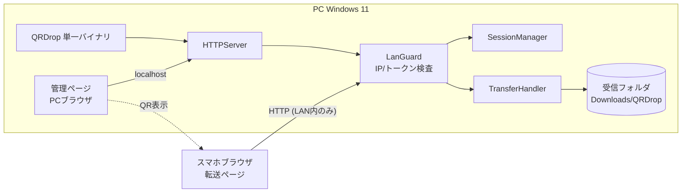
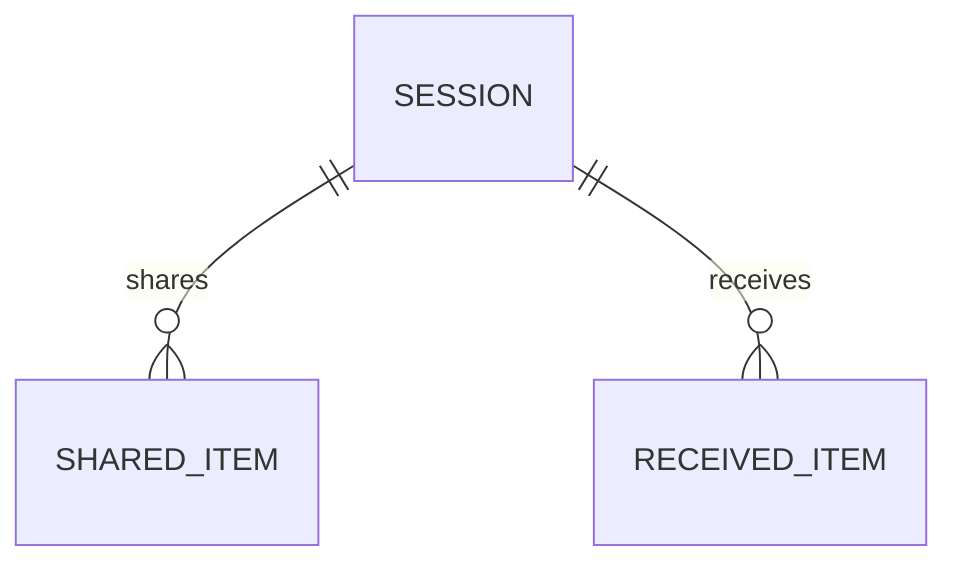

# 設計書 (Design Document) — QR コード LAN データ転送

## 変更履歴

| 日付 | 変更内容 | G2 再承認 |
|------|----------|-----------|
| 2026-07-09 | 初版(ドラフト・G2 承認待ち) | — |

## 1. 全体構成



Go 製の単一バイナリ。起動すると LAN アドレスで HTTP サーバを立ち上げ、PC の既定
ブラウザで管理ページ(localhost 経由)を開く。スマホは QR で得た URL から転送ページに
アクセスする。すべての要求は LanGuard(プライベート IP 検査+トークン検査)を通る。
外部サーバ・クラウドは一切使わない(REQ-004)。

## 2. 技術スタック

| 層 | 技術 | 選定理由 | ADR |
|----|------|----------|-----|
| サーバ本体 | Go 1.22+(net/http 標準ライブラリ) | 単一バイナリ配布・クロスコンパイル可・標準で十分な HTTP 機能 | [adr-001](adr/adr-001-architecture.md) |
| QR 生成 | github.com/skip2/go-qrcode(PNG 生成) | 実績ある MIT ライセンスの軽量ライブラリ | — |
| 画面 | サーバ埋め込みの静的 HTML/CSS/JS(go:embed)+ SSE | ビルド済みバイナリに同梱、フレームワーク不要の規模 | — |
| 通信保護 | HTTP + ワンタイムトークン + プライベート IP 検査 | 自己署名 HTTPS はスマホの警告で QR 体験を壊すため不採用 | [adr-002](adr/adr-002-transport-security.md) |

## 3. コンポーネント設計

### DES-001: Bootstrap(起動・NIC 検出)

- **責務**: LAN の IPv4 アドレス検出(プライベート範囲のインターフェースを列挙、複数あれば管理ページで選択)、空きポートの確保(既定 8931、使用中なら自動加算)、管理ページの自動オープン(`http://127.0.0.1:<port>/admin`)。LAN 未接続時はエラー表示して終了(REQ-001 異常系)。
- **対応要件**: REQ-001
- **インターフェース**: `main()` からの起動シーケンス
- **依存**: DES-002, DES-006

### DES-002: SessionManager

- **責務**: トークンの生成(`crypto/rand` 128bit → base64url)、TTL 管理(既定 30 分、失効時に転送ページへ 403 + 再読取案内)、手動失効と再発行(REQ-005)。トークンとセッション状態(作成時刻、接続済みデバイス数)をメモリ保持。
- **対応要件**: REQ-001, REQ-005, NFR-002
- **インターフェース**: `NewSession() Session` / `Validate(token) error` / `Revoke()`
- **依存**: なし

### DES-003: TransferHandler

- **責務**: アップロード(`POST /s/<token>/upload`、multipart streaming で受信フォルダへ直接書き出し=メモリに全量を載せない)、ダウンロード(`GET /s/<token>/files/<id>`)、テキスト送受(`POST/GET .../text`)。同名ファイルは ` (1)` 連番付与(REQ-002)。サイズ上限 2GB、超過時 413(NFR-001/002)。共有一覧・テキストはメモリ保持のみ(NFR-005)。
- **対応要件**: REQ-002, REQ-003, REQ-006, NFR-001, NFR-005
- **インターフェース**: HTTP ハンドラ群(§5 API 一覧)
- **依存**: DES-002, DES-004, ファイルシステム

### DES-004: LanGuard(セキュリティミドルウェア)

- **責務**: 全要求に対し (1) 接続元 IP がプライベート範囲(RFC1918 + リンクローカル)であること、(2) `/admin` はループバックのみ許可、(3) `/s/<token>/...` はトークン有効性、を検査。違反は 403。ファイル名サニタイズ(`filepath.Base` + 禁止文字除去)でパストラバーサル防止。UPnP 等のポート開放要求は実装しない(NFR-002 / REQ-004)。
- **対応要件**: REQ-004, NFR-002
- **インターフェース**: `http.Handler` ミドルウェア
- **依存**: なし

### DES-005: WebUI(管理ページ・転送ページ)

- **責務**: 管理ページ(QR 表示、受信一覧、送信ファイル追加 D&D、テキスト送受、セッション終了ボタン)と転送ページ(ファイル選択・送信、共有一覧・ダウンロード、テキスト送受、進捗バー)。一覧更新は SSE(`GET .../events`)で即時反映(REQ-003 の「数秒以内」)。モバイルファーストの単一 CSS。
- **対応要件**: REQ-001, REQ-002, REQ-003, REQ-006
- **インターフェース**: 静的アセット(go:embed)
- **依存**: DES-003 の API

### DES-006: QRDisplay

- **責務**: `http://<LAN-IP>:<port>/s/<token>` の QR コード PNG 生成(`GET /admin/qr.png`)。セッション再発行時に自動更新。
- **対応要件**: REQ-001
- **依存**: DES-002, go-qrcode

### DES-007: Logging

- **責務**: 接続元 IP・操作(upload/download)・ファイル名・結果・拒否理由をローカルログ(`%APPDATA%\QRDrop\logs\`)へ出力。**ファイル内容・テキスト本文は記録しない**(NFR-004)。
- **対応要件**: NFR-004

## 4. データモデル



| エンティティ | 属性 | 型 | 制約 | 保持場所 |
|--------------|------|-----|------|----------|
| Session | token, createdAt, expiresAt | string/time | token 一意・128bit 乱数 | メモリ |
| SharedItem(PC→スマホ) | id, kind(file/text), name, size, path or text | string/int64 | path は PC ローカル絶対パス | メモリ |
| ReceivedItem(スマホ→PC) | id, kind, name, size, savedPath, receivedAt | string/int64 | savedPath は受信フォルダ配下のみ | ファイル+メモリ(一覧) |

アプリ終了で SESSION・一覧は消える。ディスクに残るのは受信ファイル本体のみ(NFR-005)。

## 5. 外部インターフェース

### API 一覧

| メソッド | パス | 概要 | 対応 DES |
|----------|------|------|----------|
| GET | `/admin` | 管理ページ(ループバックのみ) | DES-005 |
| GET | `/admin/qr.png` | QR コード画像 | DES-006 |
| POST | `/admin/share` | PC 側の共有追加(ファイル/テキスト) | DES-003 |
| POST | `/admin/session/revoke` | セッション終了・再発行 | DES-002 |
| GET | `/s/<token>` | 転送ページ(スマホ) | DES-005 |
| POST | `/s/<token>/upload` | スマホ→PC アップロード(multipart) | DES-003 |
| GET | `/s/<token>/items` | 共有一覧(JSON) | DES-003 |
| GET | `/s/<token>/files/<id>` | PC→スマホ ダウンロード | DES-003 |
| POST | `/s/<token>/text` | テキスト送信 | DES-003 |
| GET | `/s/<token>/events` / `/admin/events` | SSE(一覧更新通知) | DES-005 |

### 画面一覧

| 画面 | 概要 | 対応 REQ |
|------|------|----------|
| 管理ページ(PC) | QR 表示・受信一覧・共有追加・セッション終了 | REQ-001, 002, 003, 005 |
| 転送ページ(スマホ) | アップロード・共有一覧・ダウンロード・テキスト | REQ-002, 003, 006 |
| エラーページ | 403(LAN 外・失効)時の案内(再読取促し) | REQ-004, 005 |

## 6. エラー処理・ログ方針

- 4xx: LAN 外アクセス・無効/失効トークン(403、遮断理由はログのみに詳細記録し、応答には最小情報)、サイズ超過(413)、不正ファイル名(400)。
- 5xx: ディスク書込失敗等。転送ページには「PC 側のエラー」と再試行案内を表示。
- アップロード中断(スマホのスリープ等): 部分ファイルは `.part` 拡張子で書き、完了時にリネーム。中断残骸は起動時に削除。
- ログ: DES-007 の方針(内容は記録しない)。

## 7. セキュリティ設計

DEC-004 の多層防御を実装に落とす(すべて NFR-002 / REQ-004 対応):

1. **バインド**: 選択した LAN インターフェース + ループバックのみで Listen(0.0.0.0 でも良いが LanGuard で遮断されるため二重化)。
2. **接続元検査**: RemoteAddr がプライベート範囲外 → 403。`/admin` はループバック限定。
3. **トークン**: 128bit 暗号乱数、URL パスで伝達、TTL 30 分、手動失効可。検証は定数時間比較。
4. **ポート開放をしない**: UPnP/NAT-PMP 非実装。ルーターのポートフォワード設定は README で明示的に非推奨と記載。
5. **入力検証**: ファイル名サニタイズ(パストラバーサル防止)、サイズ上限、Content-Type 非依存の保存(実行はしない)。
6. **平文 HTTP のリスク**: 同一 LAN 内の盗聴には無防備(ADR-002 で受容判断)。信頼できない LAN での利用は README で非推奨。

## 8. 開発環境・規約

- セットアップ手順:
  ```
  winget install GoLang.Go
  git clone <repo> && cd qrdrop
  go build ./cmd/qrdrop
  .\qrdrop.exe
  # 初回起動時に Windows ファイアウォールの受信許可ダイアログで「許可」する(プライベートネットワークのみ)
  ```
- ディレクトリ構成:
  ```
  qrdrop/
  ├── cmd/qrdrop/main.go     # DES-001
  ├── internal/session/      # DES-002
  ├── internal/transfer/     # DES-003
  ├── internal/guard/        # DES-004
  ├── internal/web/          # DES-005, 006 (go:embed 静的アセット)
  └── internal/logging/      # DES-007
  ```
- コーディング規約: `gofmt` + `go vet` + `staticcheck`
- ブランチ戦略: `feature/TASK-xxx-<slug>` → PR → main

## 9. デプロイ構成

- 配布: `go build` による単一 exe。インストーラなし、任意フォルダで実行。
- ロールバック: 旧 exe に差し替えるのみ(永続データは受信ファイルのみで互換性問題なし)。
- クロスコンパイル余地: `GOOS=darwin/linux` でビルド可(初版の動作確認は Windows のみ = DEC-002)。

## 10. 要件カバレッジ表

| 要件 | 対応 DES | 備考 |
|------|----------|------|
| REQ-001 | DES-001, DES-002, DES-006(+DES-005 表示) | |
| REQ-002 | DES-003, DES-005 | 連番保存含む |
| REQ-003 | DES-003, DES-005 | SSE で即時反映 |
| REQ-004 | DES-004 | 多層防御(§7) |
| REQ-005 | DES-002 | TTL + 手動失効 |
| REQ-006 | DES-005 | Could。進捗は XHR upload.onprogress |
| NFR-001 | DES-003 | ストリーミング書込。P4 で 100MB 実測 |
| NFR-002 | DES-002, DES-003, DES-004 | |
| NFR-003 | — | N/A(要件定義書参照) |
| NFR-004 | DES-007 | |
| NFR-005 | DES-003 | メモリ保持のみ |
