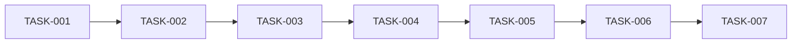

# 実装計画 (Implementation Plan) — QR コード LAN データ転送(QRDrop)

## タスク一覧

> 粒度: 1タスク = 半日以内相当。状態: `TODO / DOING / DONE / BLOCKED`
> 並列分担時は担当欄で衝突を防ぐ。

| ID | タスク | 対応 DES/REQ | 依存 | 完了条件 | 状態 | 担当 |
|----|--------|--------------|------|----------|------|------|
| TASK-001 | Go モジュール雛形 + Logging | DES-007 | — | `go build ./...` 成功。ログが `%APPDATA%\QRDrop\logs\` に出力され、本文/内容を含まない | DONE | Implementer |
| TASK-002 | SessionManager(トークン生成・TTL・失効) | DES-002 / REQ-001, 005, NFR-002 | TASK-001 | 単体テストで生成・検証・TTL失効・手動失効・再発行が Pass | DONE | Implementer |
| TASK-003 | LanGuard(IP 検査・トークン検査・サニタイズ) | DES-004 / REQ-004, NFR-002 | TASK-002 | 単体テストでプライベート/パブリック IP 判定、/admin ループバック限定、無効トークン 403、ファイル名サニタイズが Pass | DONE | Implementer |
| TASK-004 | TransferHandler(upload/download/text/items) | DES-003 / REQ-002, 003, 006, NFR-001, 002, 005 | TASK-003 | 単体テストで multipart 保存(.part→rename、連番)、2GB 上限 413、ダウンロード、テキスト送受が Pass | DONE | Implementer |
| TASK-005 | WebUI(管理/転送ページ)+ SSE + QRDisplay | DES-005, 006 / REQ-001, 002, 003, 006 | TASK-004 | 管理ページ・転送ページが配信され、QR PNG が生成され、SSE で一覧更新イベントが届く(httptest で確認) | TODO | Implementer |
| TASK-006 | Bootstrap(NIC 検出・ポート確保・ブラウザ起動・main 統合) | DES-001 / REQ-001 | TASK-005 | exe を起動すると管理ページが開き QR が表示される(実機確認)。LAN 未接続時はエラー表示 | TODO | Implementer |
| TASK-007 | README(セットアップ・非推奨事項・AP アイソレーション案内) | ADR-001, 002 / REQ-004 | TASK-006 | README 記載の手順どおりにビルド・起動できることを確認 | TODO | Implementer |

## 実施順序

## タスク実施記録

> タスク完了時に追記する。

| ID | 完了日 | ブランチ/PR | 検証内容(実行したコマンド・確認した動作) |
|----|--------|-------------|--------------------------------------------|
| TASK-001 | 2026-07-12 | feature/TASK-001-qrdrop-scaffold | `gofmt -l .`(差分なし)/ `go vet ./...` / `go test ./...`(logging 1件 Pass)。ログ出力内容に操作・IP・ファイル名のみ含まれることをテストで確認 |
| TASK-002 | 2026-07-12 | feature/TASK-002-qrdrop-session | `gofmt -l .` / `go vet` / `go test ./internal/session/`(4件 Pass)。128bit=22文字、定数時間比較、TTL 境界(29分/31分)、Revoke 後の旧トークン拒否を確認 |
| TASK-003 | 2026-07-12 | feature/TASK-003-qrdrop-guard | `gofmt` / `go vet` / `go test ./internal/guard/`(6件 Pass)。パブリック IP 遮断(有効トークンでも)、/admin ループバック限定、失効トークン 403、`/` 直叩き 403、トラバーサル文字列 13 パターンのサニタイズを確認 |
| TASK-004 | 2026-07-12 | feature/TASK-004-qrdrop-transfer | `gofmt` / `go vet` / `go test ./internal/transfer/`(10件 Pass)。streaming 保存・.part 除去・連番保存(doc (1).txt)・トラバーサル名の封じ込め・上限超過 413 と残骸なし・テキスト送受・共有/ダウンロード・SSE 通知を確認 |

## 積み残し(TODO/FIXME の転記先)

| 内容 | 発生元 | 対応方針 |
|------|--------|----------|
| — | — | — |
